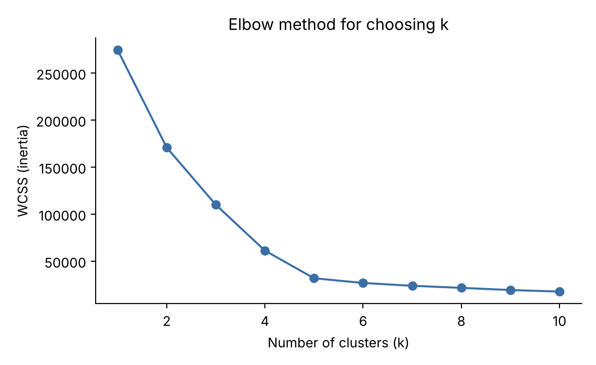
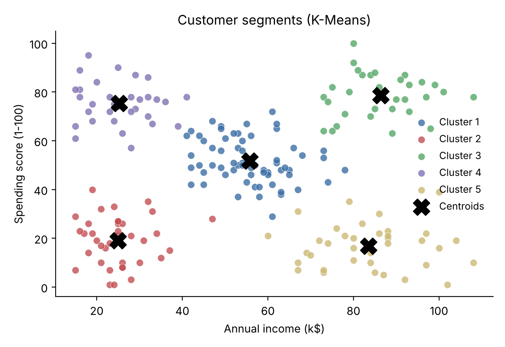

# Mall Customer Segmentation (K-Means)

A small data-mining project that groups shopping-mall customers into segments
based on their **annual income** and **spending score**, using the **K-Means**
clustering algorithm. The number of clusters is chosen with the **elbow method**
and the **silhouette score**, and each resulting segment is profiled and
interpreted.

> Mini project for the **Data Mining Lab (24SCP-308)** course
> University Institute of Computing (UIC), Chandigarh University.

---

## What it does

- Loads a dataset of 200 mall customers (`data/Mall_Customers.csv`).
- Finds the best number of clusters using the elbow method and silhouette score.
- Fits K-Means and assigns every customer to a segment.
- Saves the plots and prints a profile (size, average age, income, spending) of each segment.

---

## Results

The silhouette score and the elbow both point to **k = 5** clusters. The five
customer segments found are:

| Cluster | Segment    | Customers | Avg income (k$) | Avg spending |
|:-------:|------------|:---------:|:---------------:|:------------:|
| 1       | Standard   | 63        | 55.7            | 51.7         |
| 2       | Careful    | 38        | 24.9            | 19.1         |
| 3       | Target     | 31        | 86.4            | 78.5         |
| 4       | Careless   | 32        | 25.2            | 75.4         |
| 5       | Sensible   | 36        | 83.5            | 16.8         |

| Elbow method | Customer segments |
|:---:|:---:|
|  |  |

---

## Installation

Requires **Python 3.8+**.

```bash
git clone https://github.com/SavioTito/Mall-Customer-Segmentation.git
cd Mall-Customer-Segmentation

python -m venv .venv
source .venv/bin/activate        # on Windows: .venv\Scripts\activate

pip install -r requirements.txt
```

---

## Usage

```bash
python main.py
```

This prints the chosen number of clusters and the segment profiles, and saves
the plots and the labelled dataset to the `outputs/` folder.

---

## Project structure

```
mall-customer-segmentation/
├── main.py               # runs the full pipeline
├── segmentation.py       # data-mining logic (load, elbow, K-Means, plots, profiles)
├── data/
│   └── Mall_Customers.csv
├── outputs/              # generated plots and labelled data
├── requirements.txt
├── LICENSE
└── README.md
```

---

## How it works

1. **Load** the customer data with pandas.
2. **Choose k**: run K-Means for k = 1…10, plot the within-cluster sum of squares
   (elbow method) and compute the silhouette score; both indicate k = 5.
3. **Cluster**: fit K-Means with k = 5 and assign each customer to a segment.
4. **Profile**: compute the average age, income, and spending of each segment and
   interpret them (for example, high income / high spending = "Target" customers).

---

## Author

**Savio Tito** — UID 24BSC10046
BSc. Computer Science, Batch 24BSC-1
University Institute of Computing, Chandigarh University

## License

Released under the [MIT License](LICENSE).
# Mall-Customer-Segmentation
